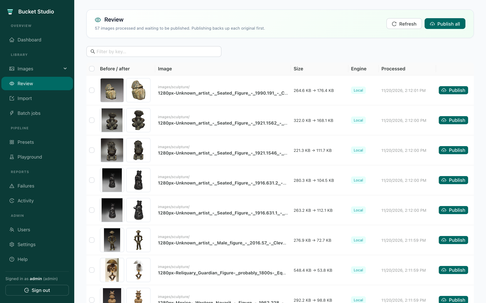
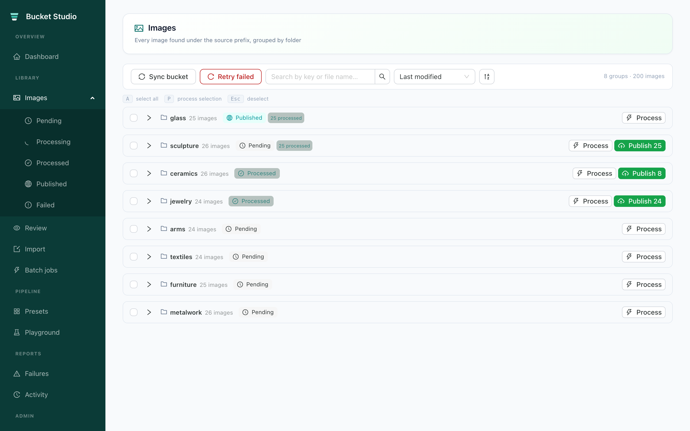
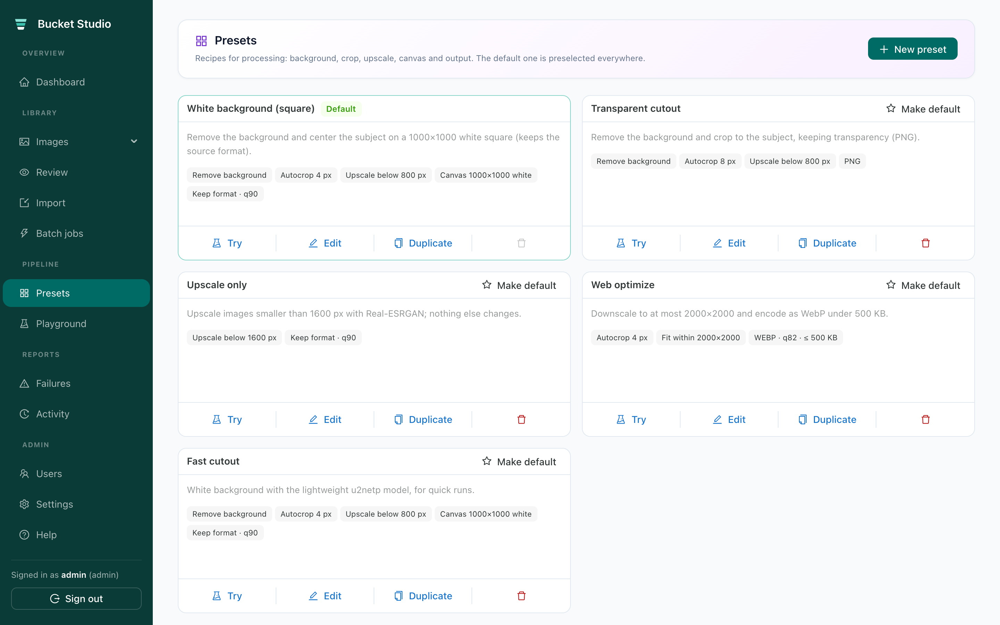
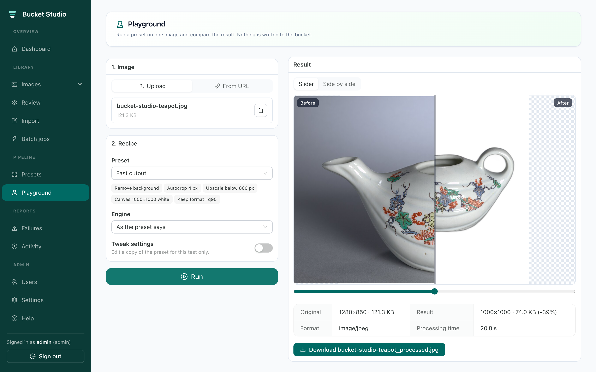
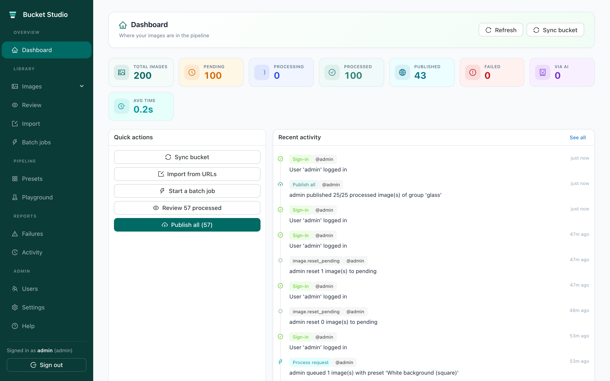
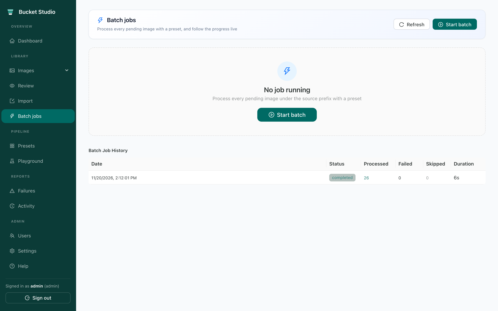
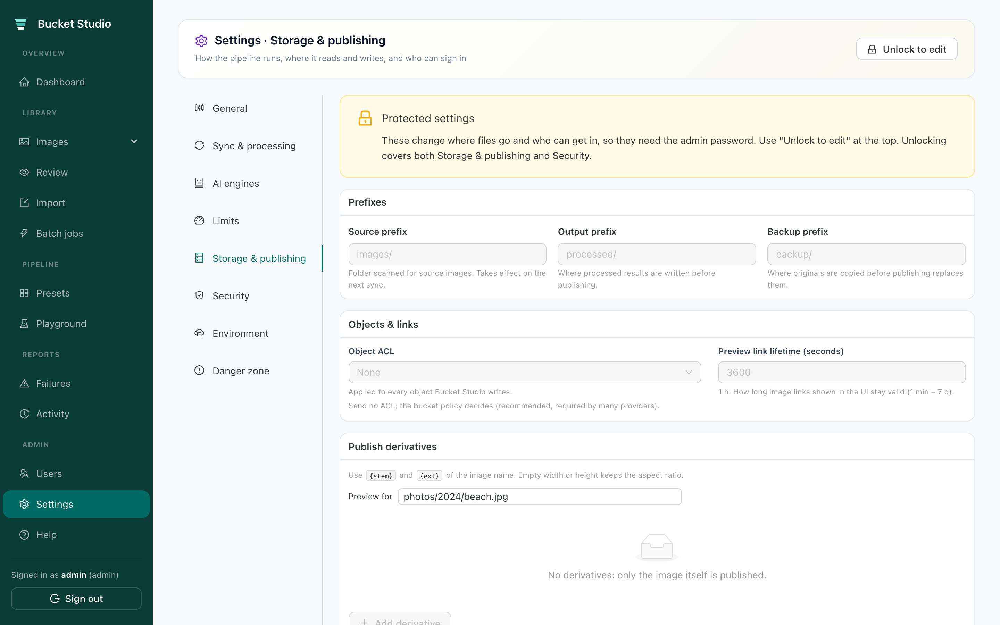
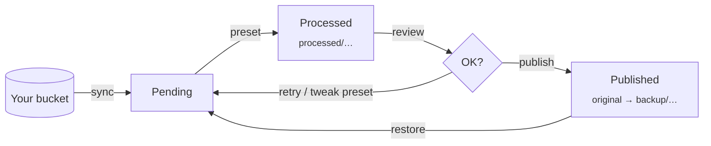

<div align="center">


# Bucket Studio

**A self-hosted image pipeline for S3 buckets.**<br>
Remove backgrounds, upscale, resize and convert thousands of images, review every result, then publish
in place with an automatic backup and one-click rollback.

[](https://github.com/derar-sattouf-dev/bucket-studio/actions/workflows/ci.yml)
[](LICENSE)



</div>

## Why

Background removal on its own is easy. Doing it to the 20,000 images that already sit in your bucket
safely, with a human in the loop and a way back, is not. Bucket Studio is the workflow around the models:

**sync your bucket → process in bulk with a preset → review before/after → publish in place → roll back if needed**

It works with any S3-compatible storage (AWS S3, Cloudflare R2, DigitalOcean Spaces, Backblaze B2,
MinIO…) and runs on a single server with no GPU and no per-image fees.

Typical uses: online-store catalogs, marketplace and classifieds listings, real-estate and car photos,
CMS and media libraries, team or profile photos.

## Features

- **Presets:** composable pipelines: background removal ([BiRefNet](https://github.com/ZhengPeng7/BiRefNet)
  via [rembg](https://github.com/danielgatis/rembg)), autocrop, [Real-ESRGAN](https://github.com/xinntao/Real-ESRGAN)
  upscaling, square canvas or transparency, resizing, JPEG/PNG/WebP output with size limits. Four built in.
- **Human review:** before/after comparison, notes and tags, retry failures, reset to pending.
- **Users and roles:** admins and operators; a user can be deactivated (access is revoked at once) and
  reactivated without losing the account.
- **Safe publishing:** originals are backed up before being replaced; restore is one click. Thumbnails and
  format variants are generated from name templates.
- **Batch jobs:** process a whole prefix with live progress, abort/skip/stop, scheduled sync and optional
  auto-processing.
- **Playground:** try a preset (or an unsaved tweak) on a single image before running it on thousands.
- **Import from URLs:** pull images into the bucket from links.
- **Optional AI engines:** route all or only very small images to OpenAI or Google Gemini.
- **Teams:** admin/operator roles, activity log, dashboard.
- **Secure by default:** SSRF-safe fetching, login throttling, strict CSP, non-root containers, no secrets in
  the browser. See the [security model](docs/architecture.md#security-model).

<table>
  <tr>
    <td></td>
    <td></td>
  </tr>
  <tr>
    <td></td>
    <td></td>
  </tr>
  <tr>
    <td></td>
    <td></td>
  </tr>
</table>

## Quick start

Requirements: Docker with Compose v2 and about 4 GB of RAM.

```sh
git clone https://github.com/derar-sattouf-dev/bucket-studio.git
cd bucket-studio
./scripts/init-env.sh                     # creates .env with random secrets and prints your login
docker compose --profile dev up --build   # MinIO + backend + UI
```

Open **http://localhost:5173** and sign in with the credentials printed by `init-env.sh`.

Load some sample images (public-domain photos) and process them:

```sh
./scripts/seed-demo.sh
```

Then go to **Images → Process**. The first run downloads the background-removal model (~1 GB) into a
Docker volume; choose the lighter `u2netp` model in a preset if you just want to try things quickly.

For production with your own bucket and HTTPS, see **[docs/deployment.md](docs/deployment.md)**.

## How it works



Nothing touches your originals until you publish, and publishing always keeps a backup. Details:
[docs/architecture.md](docs/architecture.md).

## Configuration

Secrets and storage live in `.env`; everything else is configured in the UI (**Settings**, **Presets**).
All options: **[docs/configuration.md](docs/configuration.md)**.

| | |
|---|---|
| Storage | `S3_ENDPOINT_URL`, `S3_ACCESS_KEY`, `S3_SECRET_KEY`, `S3_BUCKET`, `S3_REGION` |
| Bucket layout | `SOURCE_PREFIX` (`images/`), `OUTPUT_PREFIX` (`processed/`), `BACKUP_PREFIX` (`backup/`) |
| Accounts | `AUTH_USERNAME`, `AUTH_PASSWORD`, `ADMIN_PASSWORD`, `JWT_SECRET` |
| AI engines | `OPENAI_API_KEY`, `GEMINI_API_KEY` (optional) |

## Tech stack

**Backend:** Python 3.11, FastAPI, SQLAlchemy + Alembic (SQLite), boto3, rembg/ONNX Runtime, PyTorch
(CPU) + Real-ESRGAN, Pillow, OpenCV.
**Frontend:** React 19, TypeScript, Vite, Ant Design.
**Ops:** Docker Compose, unprivileged nginx, GitHub Actions (lint, tests, dependency audits, multi-arch
images on GHCR with provenance).

## Limitations

- Processing runs on the CPU: background removal takes several seconds per image.
- One backend process (job state is in memory), so it scales vertically rather than horizontally.
- "Publish all" runs in the background and keeps its progress in memory: a backend restart stops it (what was
  published stays published; start it again for the rest).
- Publishing replaces images in place, so a preset's output format must match the source format. The default
  preset keeps it; *Transparent cutout* (PNG) and *Web optimize* (WebP) are meant for the Playground or for
  PNG/WebP sources.
- Real-ESRGAN upscaling is slow on a CPU (about a minute for an 800 px image), so images above one megapixel
  are upscaled with Lanczos instead.
- One bucket per installation; sources, processed results and backups live under three prefixes of it.
- JPEG, PNG and WebP only.
- The interface is in English only.

## Roadmap

- GPU support for faster processing
- Local-filesystem storage in addition to S3
- Webhooks when a batch finishes
- Preset import/export

## Contributing

Contributions are welcome. Please read [CONTRIBUTING.md](CONTRIBUTING.md); for security issues see
[SECURITY.md](SECURITY.md).

## License

[MIT](LICENSE). Bucket Studio uses third-party models and libraries under their own licenses; see
[THIRD_PARTY_NOTICES.md](THIRD_PARTY_NOTICES.md). Sample images: [credits](docs/screenshots/CREDITS.md).
