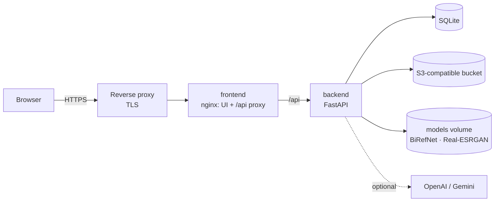
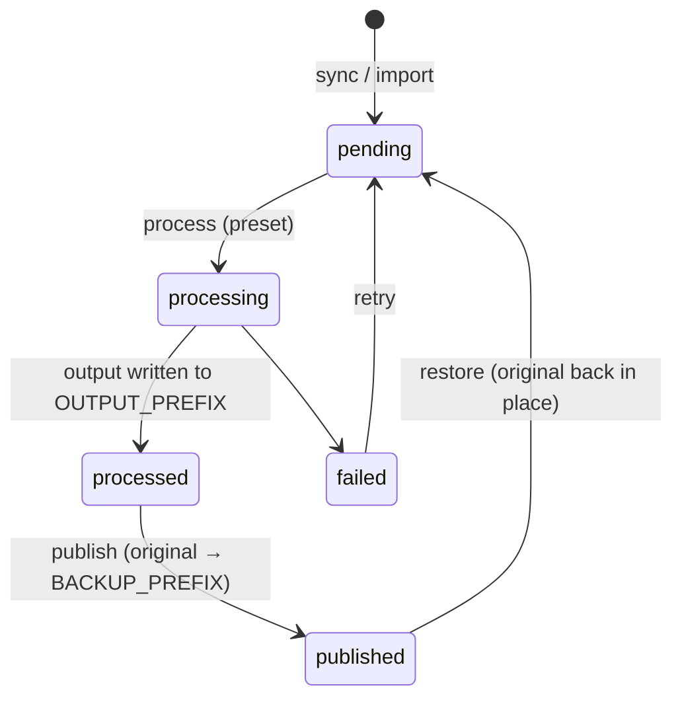

# Architecture

## Overview



- **Frontend:** React + Ant Design, served by unprivileged nginx. The same nginx proxies `/api` to the
  backend, so the UI and API share one origin: no CORS, and the backend is never exposed directly.
- **Backend:** FastAPI app that owns the database, talks to S3, runs the image pipeline and streams
  progress over Server-Sent Events.
- **State:** SQLite holds images, presets, settings, users and the activity log. Running jobs live in
  memory, so the backend runs as **one process** (`--workers 1`). Images stuck in `processing` after a
  restart are reset to `pending`.

## Image lifecycle



1. **Sync** lists `SOURCE_PREFIX`, applies the source filters, and inserts new images as `pending`.
   `group_key` is derived from the first `GROUP_DEPTH` folders.
2. **Process** runs a preset (see [configuration.md](configuration.md#presets)) and writes the result to
   `OUTPUT_PREFIX`. Batch jobs do the same for a whole prefix.
3. **Review** shows before/after for processed images.
4. **Publish** copies the original to `BACKUP_PREFIX`, records that backup location on the image, and only
   then writes the processed image over the original key and generates the configured derivatives. A backup
   is never written twice: already-published images are refused, one image is published by one request at
   a time, and retrying a publish that failed half-way reuses the recorded backup instead of copying the
   (already replaced) source over it.
   "Publish all" (and publishing a whole group) runs as one background task at a time: the request returns
   `202` and `GET /images/publish-all/status` reports the progress; the run writes a single activity entry.
5. **Restore** copies the backup back, regenerates the derivatives from it, and resets the image to `pending` so it can be processed again.

## Processing pipeline

`core/processor.py` implements the stages: contrast → background removal (rembg) → autocrop → upscale
(Real-ESRGAN) → canvas / resize → encode. `core/preset_config.py` defines the validated `PresetConfig`,
`core/rendering.py` decides between the local pipeline and an AI engine, and `core/image_pipeline.py`
runs one image end to end (download → render → upload → DB status).

- Blocking work (Pillow, ONNX, torch, boto3) runs in threads; the event loop only coordinates. Whole-image
  jobs use their own thread pool (one thread per allowed `process_concurrency`), so a busy batch does not
  hold up the `asyncio.to_thread` calls behind listing, signing and publishing.
- **Lists are bounded.** The review and failed lists are paginated and searched on the server, and the
  image list returns at most 50 images per group plus the group's real size (`GET /images/group` pages
  through the rest). Group-wide actions resolve the group's keys on the server.
- **Cancellation is cooperative.** Abort, skip and stop cancel a `CancelToken`, which the pipeline checks
  between stages and before uploading. The upload is the commit point, so a cancelled image is never
  marked as processed.
- Models are downloaded on first use into `MODELS_DIR` (`core/model_store.py`); Real-ESRGAN weights are
  verified against a SHA-256 checksum before every load and read as plain tensors (`weights_only`). The
  network and its tiled inference live in `core/esrgan.py` (no `basicsr`/`realesrgan` dependency).
  Upscaling is serialized with a lock: one run already uses every core and about 2 GB.

## Security model

| Area | Measure |
|---|---|
| **Authentication** | Login returns an HS256 JWT (`iss`, `iat`, `exp`; 12 h by default). Every request re-loads the user, so deleting or deactivating a user revokes access immediately. Optional `X-API-Key` header for integrations. |
| **Authorization** | Admin and operator roles. Admin-only: users, settings changes, presets, publish/source configuration, database reset, overwriting originals. Sensitive actions also require the separate `ADMIN_PASSWORD`; database reset requires typing `RESET`, is refused while a batch job, sync or bulk publish is running, and rebuilds the schema through the Alembic migrations. |
| **Passwords** | bcrypt, minimum 8 characters, 72-byte limit enforced, constant-time handling of unknown users. |
| **Brute force** | Failed logins are throttled per client IP + username and per IP (429 + `Retry-After`). nginx overwrites `X-Forwarded-For`, so clients cannot spoof their IP. |
| **SSRF** | Every user-supplied URL (imports, Playground) goes through `core/net.py`: http/https on standard ports only, DNS resolved once and **every** address must be public, the connection is pinned to the validated IP (no DNS rebinding), each redirect is re-validated, and size and time are capped. |
| **Input limits** | Request sizes, list lengths, string lengths and numeric ranges are validated on every model; uploads are size-limited; `Image.MAX_IMAGE_PIXELS` turns decompression bombs into errors. Storage keys are validated against the configured prefixes. |
| **Tokens** | Never placed in URLs. SSE streams use `fetch` with the `Authorization` header. |
| **Errors** | Responses never include raw exception text or upstream errors. A failed image carries a fixed message (for storage errors, the provider's error code such as `AccessDenied`); the detail is logged server-side. |
| **Headers** | API: `nosniff`, `X-Frame-Options: DENY`, `no-referrer`, `no-store`. UI: strict Content-Security-Policy (`script-src 'self'`), Permissions-Policy, COOP. |
| **Containers** | Non-root users, `no-new-privileges`, all capabilities dropped, size-capped logs, backend not published. |
| **Supply chain** | Locked Python dependencies, `pip-audit` and `pnpm audit` in CI, Dependabot, multi-arch images with build provenance and SBOM. |

Known trade-offs: the session token is kept in `localStorage` (mitigated by the strict CSP), and rate
limiting and job state are in-memory (single process).

## Code layout

```
backend/app/
  main.py            app setup: lifespan (migrations, preset seeding, recovery, scheduler), middleware, routers
  config.py          environment settings
  api/               HTTP routes only: validation and error mapping
  services/          use cases: images, publish, presets, imports, playground, sync, jobs, settings,
                     users, sign-in
  core/              building blocks: pipeline, presets, rendering, S3, derivatives, source filters,
                     cancellation, model store, auth/JWT/passwords/rate limit, SSRF-safe fetching
  db/                SQLAlchemy models, queries, Alembic migrations (run on startup)
  models/schema.py   request/response schemas
backend/tests/       pytest suite (in-memory S3 fake; tests never download models, and a fixture
                     fails any real network connection)

frontend/src/
  app/               shell: layout, navigation, lazy routes
  api/               typed API client (fetch, errors, SSE) — one module per area
  auth/              token storage, auth context, route guards
  features/<area>/   one folder per page: images, review, presets, playground, imports, jobs, …
  components/ hooks/ types/ utils/ constants/
```

Schema changes need an Alembic revision (`alembic revision --autogenerate -m "…"` from `backend/`).
